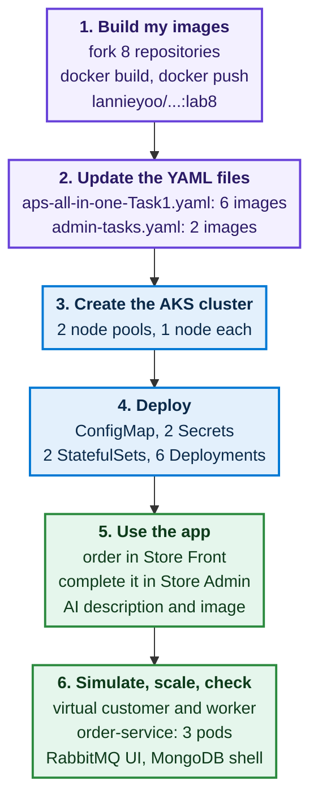
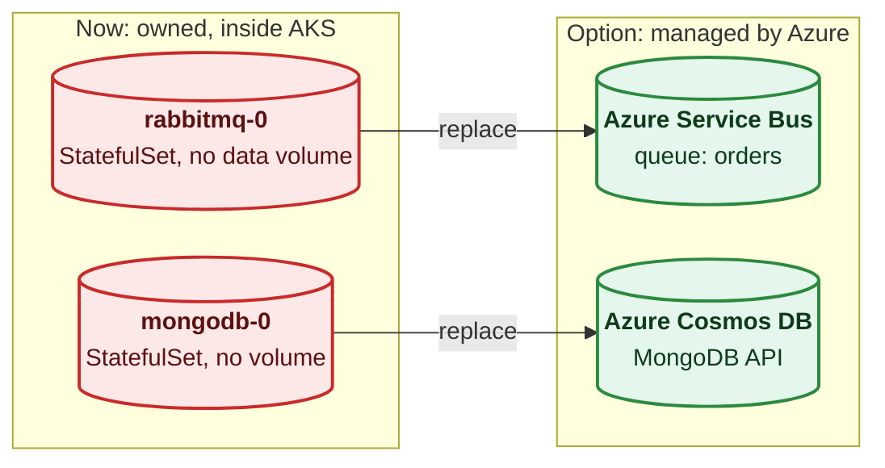

# CST8915 Lab 8: Algonquin Pet Store (On Steroids) on AKS

- **Student Name**: Hye Ran Yoo
- **Student ID**: 041145212
- **Course**: CST8915 Full-stack Cloud-native Development
- **Semester**: Fall 2026

---

## Demo Video

🎥 [Watch Demo Video](https://youtu.be/kGpd7Jytatw)

---

## What This Lab Does

1. Fork the 8 service repositories, build 8 Docker images on my computer, and push them to my Docker Hub account (`lannieyoo`, tag `lab8`).
2. Change the image names in the two YAML files to my images.
3. Create an AKS cluster with two nodes.
4. Apply the ConfigMap and the two Secrets, and deploy the app with my updated YAML file.
5. Place an order in Store Front, see it in Store Admin, and use the AI service to write a product description and make a product image.
6. Run the virtual customer and the virtual worker, scale `order-service` to 3 pods, and check the data in the RabbitMQ management UI and the MongoDB shell.

Purple is on my computer. Blue is the setup on Azure. Green is the app running.

---

## Environment

- Resource group: `AlgonquinPetStoreRG`, region Canada Central
- AKS cluster: `AlgonquinPetStoreCluster`, preset Dev/Test, pricing tier Free, Kubernetes 1.36.5
- Node pools:
  - `masterpool`: System mode, Standard_D2as_v4, Manual, 1 node
  - `workerspool`: User mode, Standard_D2as_v4, Manual, 1 node
- Commands were run in Azure Cloud Shell (Bash).
- The OpenAI keys came from the `secrets.yaml` file in Brightspace. This file is not in this repository.

---

## Task 1: My Docker Images

| Service | My fork | My image | File |
|---|---|---|---|
| store-front | `LannieYoo/store-front-L8` | `lannieyoo/store-front:lab8` | [aps-all-in-one-Task1.yaml](./aps-all-in-one-Task1.yaml) |
| store-admin | `LannieYoo/store-admin-L8` | `lannieyoo/store-admin:lab8` | [aps-all-in-one-Task1.yaml](./aps-all-in-one-Task1.yaml) |
| order-service | `LannieYoo/order-service-L8` | `lannieyoo/order-service:lab8` | [aps-all-in-one-Task1.yaml](./aps-all-in-one-Task1.yaml) |
| product-service | `LannieYoo/product-service-L8` | `lannieyoo/product-service:lab8` | [aps-all-in-one-Task1.yaml](./aps-all-in-one-Task1.yaml) |
| makeline-service | `LannieYoo/makeline-service-L8` | `lannieyoo/makeline-service:lab8` | [aps-all-in-one-Task1.yaml](./aps-all-in-one-Task1.yaml) |
| ai-service | `LannieYoo/ai-service-L8` | `lannieyoo/ai-service:lab8` | [aps-all-in-one-Task1.yaml](./aps-all-in-one-Task1.yaml) |
| virtual-customer | `LannieYoo/virtual-customer-L8` | `lannieyoo/virtual-customer:lab8` | [admin-tasks.yaml](./admin-tasks.yaml) |
| virtual-worker | `LannieYoo/virtual-worker-L8` | `lannieyoo/virtual-worker:lab8` | [admin-tasks.yaml](./admin-tasks.yaml) |

- MongoDB (`mongo:8.0.38`) and RabbitMQ (`rabbitmq:3-management`) use the official images.
- I checked the running images with `kubectl get deployments -o custom-columns=NAME:.metadata.name,IMAGE:.spec.template.spec.containers[0].image`. All six show `lannieyoo/...:lab8`.

---

## Task 2: Azure Managed Services for MongoDB and RabbitMQ

### What I saw in this lab

- MongoDB and RabbitMQ run inside my AKS cluster as StatefulSets with one pod each. So they are **owned** backing services. My team must handle setup, health monitoring, scaling, and failover.
- The MongoDB StatefulSet has no volume. The RabbitMQ StatefulSet has only the ConfigMap volume for the plugin list. It has no volume for data.
- The RabbitMQ management UI showed 188 messages waiting in the queue. The virtual customer sends 200 orders per hour, and they are taken out more slowly. If the RabbitMQ pod restarts, these messages are lost. I saw this problem in Lab 7.
- When I opened `mongosh`, it showed the warning "Access control is not enabled for the database".

### 1. MongoDB → Azure Cosmos DB (MongoDB API)

- **Name and purpose**: Azure Cosmos DB is a globally distributed, multi-model NoSQL database service. It supports the document model, and it has a MongoDB API.
- **Why it is a good fit**:
  - Each order is a JSON document with `orderid`, `customerid`, `items`, and `status`. This fits the document model.
  - `makeline-service` already supports Cosmos DB with the MongoDB API and the SQL API (see the README of my fork `makeline-service-L8`).
  - The code does not change. Only the connection settings, such as `ORDER_DB_URI`, change. This is Factor 4: a backing service is an attached resource, and its address is in the config.
- **What problem it solves**:
  - The orders are saved outside my cluster, so they are not lost when the MongoDB pod is deleted.
  - Azure handles backup, updates, and scaling. I do not need to do this myself.
  - The database is not open without access control.

### 2. RabbitMQ → Azure Service Bus

- **Name and purpose**: Azure Service Bus is a fully managed messaging system. It supports queues (point-to-point) and topics and subscriptions (publish/subscribe).
- **Why it is a good fit**:
  - In this app, `order-service` puts each order into a queue, and `makeline-service` takes it out. This is a point-to-point queue, so a Service Bus queue named `orders` fits.
  - Both `order-service` and `makeline-service` already support Azure Service Bus (AMQP 1.0, in the code and the README of `makeline-service-L8`).
  - Only the connection settings change, not the code.
- **What problem it solves**:
  - The messages stay in Azure, outside my cluster. Messages like the 188 waiting orders are not lost when a pod restarts.
  - Azure handles scaling, backup, and maintenance.
  - It is made for reliable communication with guaranteed delivery between microservices.

### The trade-off

With managed services I have less control, and the cost is based on usage.

---

## Notes

- `secrets.yaml` is not in this repository. The `.gitignore` file blocks it.
- After the demo, I deleted the resource group `AlgonquinPetStoreRG`.

---

## Acknowledgments

1. **Lab instructions**
   - [ramymohamed10/26F_CST8915_Lab8](https://github.com/ramymohamed10/26F_CST8915_Lab8)
2. **Lecture 8 slides: Backing Services**
   - Owned vs Managed Backing Services
   - Azure Service Bus
   - Azure Cosmos DB
3. **makeline-service README**
   - [LannieYoo/makeline-service-L8](https://github.com/LannieYoo/makeline-service-L8)
   - The app can use RabbitMQ or Azure Service Bus, and MongoDB or Azure Cosmos DB.
